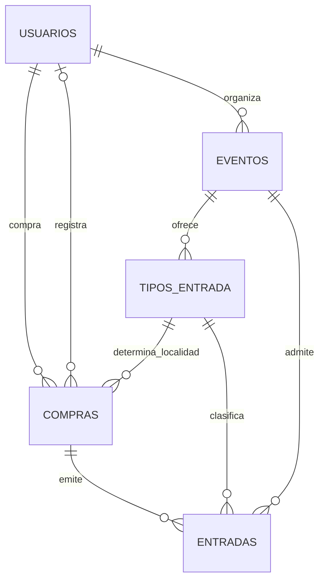

# Modelo relacional y consistencia de EventPass

## Las cinco tablas

Las claves primarias son enteros de identidad. PostgreSQL almacena los importes en `NUMERIC`. Las fechas de auditoría y emisión usan `timestamptz`. La fecha y la hora del evento se interpretan en `America/Bogota`.

| Tabla | Columnas |
|---|---|
| `usuarios` | `id`, `identificacion`, `nombre`, `usuario`, `password_hash`, `rol`, `estado`, `version_sesion`, `creado_en`, `actualizado_en` |
| `eventos` | `id`, `codigo`, `organizador_id`, `nombre`, `descripcion`, `categoria`, `ubicacion`, `fecha`, `hora`, `capacidad_total`, `estado`, `creado_en`, `actualizado_en` |
| `tipos_entrada` | `id`, `evento_id`, `nombre`, `precio`, `capacidad_asignada`, `cantidad_disponible`, `estado`, `creado_en` |
| `compras` | `id`, `codigo`, `cliente_id`, `usuario_responsable_id`, `tipo_entrada_id`, `solicitud_id`, `fecha`, `cantidad_entradas`, `valor_total`, `estado` |
| `entradas` | `id`, `codigo`, `compra_id`, `evento_id`, `tipo_entrada_id`, `precio_pagado`, `fecha_generacion`, `estado` |

Un evento tiene un organizador. Un cliente puede realizar muchas compras. Una compra corresponde a una localidad y puede emitir múltiples unidades. Las claves foráneas compuestas obligan a que la entrada comparta el tipo de su compra y pertenezca al evento de ese tipo. Al registrar una compra, tanto en autoservicio como en mostrador, el responsable inicial es el organizador del evento asociado al tipo de entrada.

## Restricciones

- Identificación y usuario son únicos. El nombre de acceso se normaliza a minúsculas. Los códigos de eventos, compras y entradas son únicos en su entidad.
- Se permiten los roles `ADMINISTRADOR`, `ORGANIZADOR` y `CLIENTE`. Las cuentas y localidades admiten `ACTIVO` o `INACTIVO`. Un evento admite `BORRADOR`, `ACTIVO` o `CERRADO`.
- Los precios unitarios son `numeric(12,2)`. El total es `numeric(22,2)`. Los precios admiten cero, el aforo y la cantidad comprada son positivos, y los cupos asignados pueden ser cero.
- Un trigger bloquea el evento y comprueba la suma de las asignaciones al crear o ampliar una localidad. Al reducir el aforo se vuelven a comprobar las asignaciones. Al reducir el cupo de una localidad, el inventario debe cubrir las unidades que ya se vendieron.
- El disponible equivale al cupo asignado menos las entradas `EMITIDA` y `UTILIZADA`. Los triggers recalculan el disponible al emitir o cambiar entradas y verifican los cambios directos al contador.
- La pareja `(cliente_id, solicitud_id)` es única. Hay índices para agenda pública, titularidad, compras del cliente o de una localidad y entradas por compra, evento, tipo y estado. Las bajas de usuarios, eventos o tipos con referencias se rechazan.

## Confirmación de una compra

1. El servicio valida sesión, rol, cliente, cantidad y UUID. Serializa solicitudes con el mismo cliente y UUID mediante un bloqueo transaccional. Un reintento idéntico recupera el comprobante existente. Una carga distinta con la misma clave devuelve un conflicto.
2. En la misma conexión se bloquean con `SELECT ... FOR UPDATE` las filas del evento y del tipo, en ese orden. El servicio comprueba que el evento es futuro y que ambos están activos.
3. Se cuentan las entradas emitidas o utilizadas para el evento. Se comprueban el aforo global restante y el inventario de la localidad. Si el cliente incluyó un precio esperado, también se compara.
4. PostgreSQL calcula `precio × cantidad` y guarda la compra. Una inserción con `generate_series` crea cada entrada con código UUID y el precio pagado. Un trigger recalcula las existencias del lote.
5. La respuesta sale después del `COMMIT`. Ante un error, el servidor ejecuta `ROLLBACK` y libera la conexión. Compra, inventario y entradas participan en la misma transacción.

## Cancelación, reemisión y control de ingreso

| Operación | Transición | Efecto en disponibilidad |
|---|---|---|
| Venta de una unidad | Nueva → `EMITIDA` | −1 |
| Validación | `EMITIDA` → `UTILIZADA` | 0 |
| Cancelación individual | `EMITIDA` → `CANCELADA` | +1 |
| Repetición de la cancelación | `CANCELADA` → `CANCELADA` | 0 |
| Reemisión administrativa | Original → `REEMPLAZADA` y nueva → `EMITIDA` | 0 neto |

La validación bloquea el evento, la localidad, la compra y la entrada. Comprueba el organizador autorizado, la compra confirmada y el estado emitido antes de actualizarlo. La validación y la cancelación compiten por las mismas filas. Una entrada usada sigue contando para el aforo.

La cancelación completa devuelve únicamente las entradas emitidas. Si existe una utilizada, el administrador puede anular individualmente las demás. Cancelar la última unidad vigente cancela también la compra. Una reemisión conserva el evento, la localidad y el importe originales. Las operaciones de baja de compras y entradas conservan el historial de códigos y los valores originales para auditoría.

## Decisiones de transformación

- El esquema PostgreSQL `eventpass` permite instalar el proyecto en una base que también aloje la tienda anterior. Los eventos y los usuarios se crean con sus propios identificadores, roles y relaciones.
- El backend conserva node-soap, pg, bcryptjs y JWT. Express integra el servicio y puede servir también React. La capa de servicios del frontend conserva el transporte XML y la navegación usa React Router.
- La agenda toma sus datos del servicio. Los formularios, el resumen del pedido y el identificador de reintento pertenecen a la interfaz. Los permisos, precios, aforos y estados pertenecen al servidor.
- La guía visual asigna rojo tanto al ejemplo de botón como a las acciones destructivas. EventPass usa azul y blanco para confirmar o navegar, rojo para errores y cancelaciones, y rojo como acento editorial. Helvetica Neue utiliza fuentes de sistema de respaldo. JetBrains Mono se sirve con el proyecto.
- El registro público crea clientes activos. El panel administrativo permite crear cuentas con cualquiera de los tres roles y cambiar el rol de cuentas compatibles con sus compras y eventos. La agenda de muestra es opcional y los códigos de acceso a los eventos son texto seleccionable que se comprueba por SOAP.

El [contrato del servicio](server/README.md) detalla operaciones, cabecera JWT y errores. El [inventario de entrega](ENTREGA.md) recoge las verificaciones ejecutadas.
